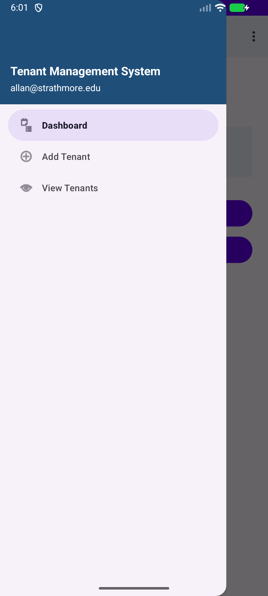
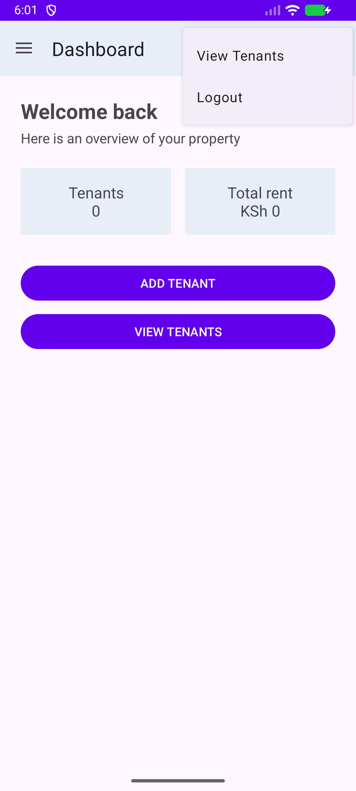
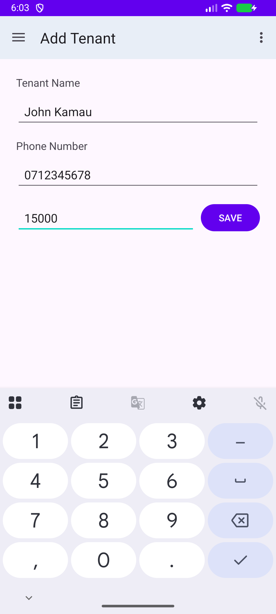
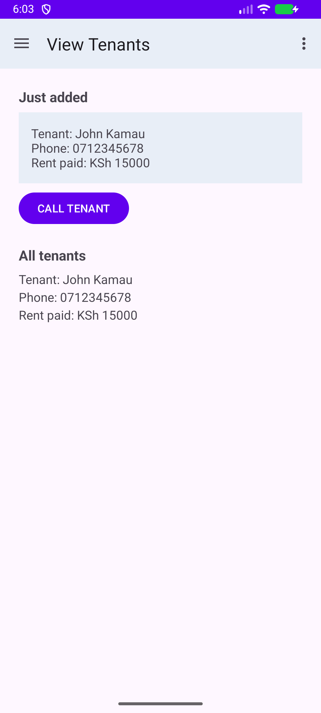
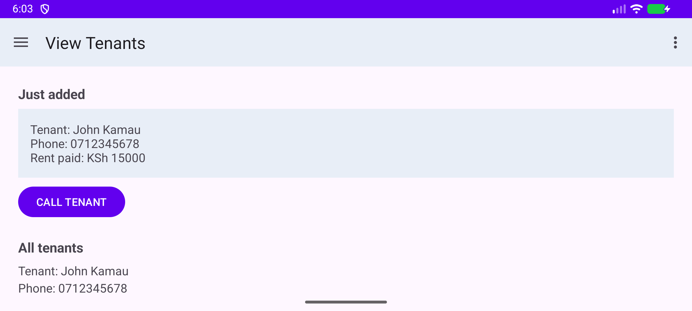
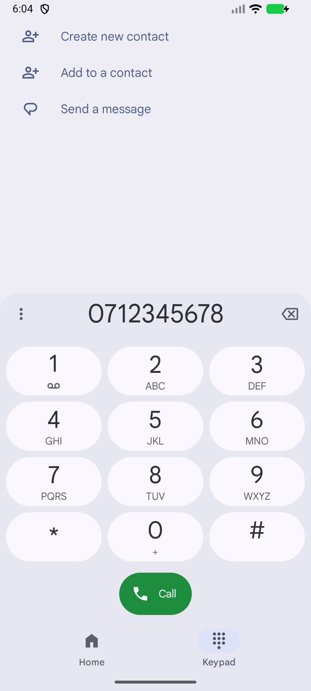
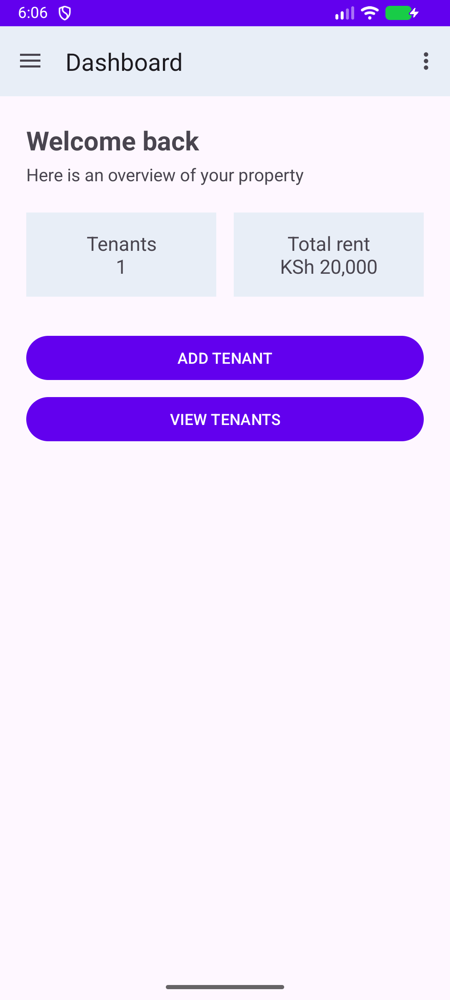
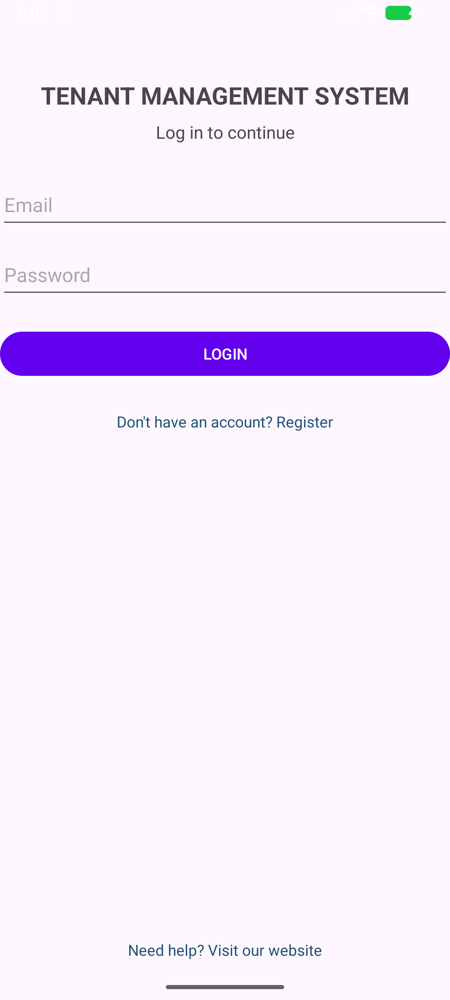

<h1 align="center">TenantManagementSystem</h1>
<p align="center">
  <em>A property manager's app built with View Binding, Data Binding and Intents.</em>
  <br>
  <br>
  <a href="#overview">Overview</a> ·
  <a href="#screenshots">Screenshots</a> ·
  <a href="#what-it-does">What It Does</a> ·
  <a href="#how-the-screens-connect">How the Screens Connect</a> ·
  <a href="#how-to-run">How to Run</a> ·
  <a href="#project-structure">Project Structure</a> ·
  <a href="#built-with">Built With</a> ·
  <a href="#build-notes">Build Notes</a> ·
  <a href="#author">Author</a>
  <br>
  
  
  
  
</p>

---

TenantManagementSystem is the Android app built for the BBT 3.2 Mobile Application Development practicals at Strathmore University. It starts with a Login and a Register screen, then opens a Dashboard hosted inside a Navigation Component: an App Bar with an options menu, a navigation drawer showing the signed-in user, and three Fragments (Dashboard, Add Tenant, View Tenants) that swap in and out of a `NavHost` with Safe Args carrying data between them.

The Lesson 6 practicals walk through the progression from a static screen, to View Binding, to Data Binding, then add navigation: multiple Activities, explicit Intents, passing data with `putExtra`, and implicit Intents that ask other apps to do things. The app is as much a demonstration of those techniques as it is a usable form.

## Overview

The app has four Activities. `LoginActivity` is the first screen: it takes an email and password, opens `MainActivity` with an explicit Intent, and links to `RegisterActivity`. `RegisterActivity` validates three fields, then returns to Login carrying the email with `putExtra("EMAIL")`. `MainActivity` is now only a frame: it holds a `MaterialToolbar`, a `FragmentContainerView` used as the `NavHost`, and a `DrawerLayout` with a `NavigationView`. Everything the user sees after logging in is a Fragment inside that NavHost.

Kotlin reaches the views through View Binding, and the result area reads a `Tenant` object directly through Data Binding. The point of the exercise is the separation of concerns. `MainActivity` builds a `Tenant` and hands it to the layout, and the layout decides how that `Tenant` is displayed. Changing the display format means editing the `Tenant` class, not the activity.

Practical 2 goes inside the Activity: it logs the Activity lifecycle so the create/pause/stop/destroy order is visible in Logcat, and it saved the last tenant in a `Bundle` so it survived a screen rotation. It then built the screens that will live inside `MainActivity` as three Fragments (Dashboard, Add Tenant and View Tenants) and maps them in a Navigation Graph. Practical 3 then connects them: `MainActivity` becomes a shell around a `NavHost`, the App Bar is driven by `setupActionBarWithNavController`, the Dashboard buttons navigate with Safe Args directions, a new tenant travels from Add Tenant to View Tenants through a typed `newTenant` argument, the back stack is fixed with `popUpTo`, destination changes are animated, an options menu and a navigation drawer are wired through `NavigationUI`, and lifecycle logs now appear for Fragments as well as Activities. Rotating the phone on View Tenants keeps the "Just added" tenant on screen without any `onSaveInstanceState` code, because the Navigation Component restores it from the back stack's arguments.

## Screenshots

<p align="center">
  
  
  
</p>
<p align="center">
  <em>Login, Register, and Login again after Register carried the email across with putExtra.</em>
</p>

### Lab 7: Navigation Practical 3

<p align="center">
  
  
  
</p>
<p align="center">
  <em>The Dashboard hosted in the NavHost, the drawer showing the email that Login passed through, and the options menu built with NavigationUI.</em>
</p>

<p align="center">
  
  
  
</p>
<p align="center">
  <em>SAVE stores the tenant and navigates with a Safe Args argument; the landscape shot keeps "Just added" after a rotation, with no saved-state code.</em>
</p>

<p align="center">
  
  
  
</p>
<p align="center">
  <em>CALL TENANT reaches the dialer with the saved number, Back from View Tenants lands on the Dashboard (not the form), and Logout clears the task and returns to Login.</em>
</p>

### Practical 1 and 2 evidence (superseded)

These pictures show the Activity-based Add Tenant screen that Practical 1 and 2 built. From Practical 3 on, that form lives in `AddTenantFragment`, SHARE TENANT is no longer part of the app, and the old Activity code is kept in git history.

<p align="center">
  
  
</p>
<p align="center">
  <em>The Activity-based Add Tenant screen as it opens, greeted with the email carried from Login, and after a tenant is saved through Data Binding.</em>
</p>

<p align="center">
  
</p>
<p align="center">
  <em>SHARE TENANT hands the saved tenant's summary to the Android share sheet through an implicit ACTION_SEND Intent.</em>
</p>

In the Activity-based version, the Add Tenant screen rendered the name in large bold text, filled the summary in through Data Binding, cleared the inputs on save, handed the saved number to the dialer, and passed the summary to any app that could send text. The fragment flow in Lab 7 keeps the form and the dialer and drops the share sheet.

## What it does

- Opens on a Login screen and reaches every view through View Binding, so a wrong id fails at compile time instead of crashing at runtime.
- Validates the Login fields and blocks the move to the dashboard when either is empty.
- Opens `MainActivity` (the Add Tenant screen) with an explicit Intent, then `finish()`es so Back does not return to Login.
- Carries the registered email from Register to Login with `putExtra("EMAIL")` / `getStringExtra`, and uses `FLAG_ACTIVITY_CLEAR_TOP` so Register does not stack a second Login.
- Greets the logged-in user: Login forwards the email to `MainActivity` with `putExtra("EMAIL")`, which shows a *Logged in as …* toast.
- Opens the Strathmore website from the Login screen with an implicit Intent (`ACTION_VIEW` + `Uri.parse`).
- Renders a `Tenant` object through Data Binding with `android:text="@{tenant.summary()}"`.
- Holds tenant data in a `Tenant` data class (`name`, `phone`, `rent`) with a `summary()` method.
- Validates the tenant name: an empty name shows a field error and blocks the save.
- Shows the saved tenant's name and summary under "Just added" on View Tenants, and clears the three inputs after a save.
- Dials the last saved tenant with an implicit Intent (`ACTION_DIAL` + `"tel:$phone"`), warning "Save a tenant first" if nothing is saved yet.
- Logs every Activity lifecycle callback under the `TENANT_LIFECYCLE` tag, so the order Android calls them in is visible in Logcat.
- Survives rotation on View Tenants without saved-state code, because the tenant is a Safe Args argument that the Navigation Component restores.
- Keeps tenants in an in-memory `TenantRepository` object that every screen shares.
- Defines `DashboardFragment`, `AddTenantFragment` and `ViewTenantsFragment`, mapped in `res/navigation/nav_graph.xml` and hosted by `MainActivity` inside a `NavHost`.
- Sets the Toolbar as the App Bar with `setSupportActionBar`, then hands it to NavigationUI with `setupActionBarWithNavController`, so the title and the up arrow follow the current destination.
- Navigates with generated Safe Args directions only; no string action id is used anywhere.
- Passes the saved tenant to View Tenants through a typed, nullable `newTenant` argument (`Tenant : Serializable`) and shows it under a "Just added" heading.
- Fixes the back stack: the Add Tenant to View Tenants action uses `popUpTo="@id/dashboardFragment"`, so Back from View Tenants lands on the Dashboard instead of the form the user has just finished with.
- Animates destination changes with enter/exit/pop animations declared on the Dashboard actions.
- Adds an options menu (`main_menu.xml`) with View Tenants and Logout: destinations navigate through `onNavDestinationSelected`, and Logout starts Login with `FLAG_ACTIVITY_NEW_TASK or FLAG_ACTIVITY_CLEAR_TASK` so Back closes the app.
- Adds a navigation drawer (`drawer_menu.xml` plus `nav_header.xml`) connected with `NavigationUI.setupWithNavController`, with `AppBarConfiguration` treating the three screens as top level so they show a drawer icon rather than an up arrow.
- Shows the signed-in email in the drawer header, read from the `EMAIL` extra that Login attached.
- Logs Fragment lifecycle callbacks too, so Activity and Fragment logs interleave in Logcat under `TENANT_LIFECYCLE`.

## How the screens connect

```
                    implicit Intent (ACTION_VIEW)
LoginActivity ───────────────────────────────────▶ Browser
   │     ▲
   │     │ explicit Intent + putExtra("EMAIL")
   │     │
   │  RegisterActivity
   │
   │ explicit Intent
   ▼
MainActivity ─── implicit Intent (ACTION_DIAL) ───▶ Phone dialer
```

An explicit Intent names the exact screen to open (`Intent(this, MainActivity::class.java)`). An implicit Intent only describes what you want done, and Android finds an app on the phone that can do it (open a web page, dial a number).

## Lifecycle and saved state

Every Activity and Fragment logs its callbacks under the tag `TENANT_LIFECYCLE`, so the order Android calls them in is visible while you use the app (`adb logcat -s TENANT_LIFECYCLE`). Fragment logs are indented by three spaces so they stand out from the Activity's in Logcat.

```text
MainActivity: onCreate
   DashboardFragment: onCreate
   DashboardFragment: onCreateView
   DashboardFragment: onViewCreated
   DashboardFragment: onStart
MainActivity: onStart
MainActivity: onResume
   DashboardFragment: onResume
```

Practical 2 saved the last tenant by hand, writing its three fields into the `Bundle` in `onSaveInstanceState()` and reading them back in `onCreate()`. Practical 3 deletes that code: the tenant now travels to View Tenants as a Safe Args argument, and the Navigation Component restores it with the back stack, so rotating the phone on View Tenants keeps "Just added" on screen with no saved-state code at all. EditText contents still survive on their own, because Android saves and restores any field that has an id.

## Fragments and the navigation graph

`MainActivity` now hosts the three screens as Fragments:

- `DashboardFragment`: shows the tenant count and total rent from the shared `TenantRepository`, with buttons to Add Tenant and View Tenants.
- `AddTenantFragment`: the Add Tenant form; SAVE validates the name (and refuses a phone number with fewer than ten digits), stores the tenant, then navigates to View Tenants.
- `ViewTenantsFragment`: the just-added tenant under "Just added" plus the list of all tenants, with CALL TENANT opening the dialer.

`res/navigation/nav_graph.xml` maps them: `DashboardFragment` is the start destination and has animated actions to Add Tenant and to View Tenants; Add Tenant has an action to View Tenants with `popUpTo="@id/dashboardFragment"`; View Tenants takes an optional, nullable `newTenant` argument. `Tenant` is `Serializable`, so Safe Args puts it in a `Bundle` and generates `DashboardFragmentDirections`, `AddTenantFragmentDirections` and the type-safe `ViewTenantsFragmentArgs`.

`MainActivity` never knows which screen is showing. Every button, menu item and drawer item is routed through the same `NavController`, which is why the Activity shrinks to an App Bar, a `NavHost` and a drawer.

## How to run

### Android Studio (recommended)

1. Open the project folder in Android Studio.
2. Let Gradle sync finish.
3. Start an emulator from Device Manager, or connect a device with USB debugging enabled.
4. Select the `app` run configuration and press Run.

### Command line

Build a debug APK:

```bash
./gradlew assembleDebug
```

Install and launch on a running emulator or connected device:

```bash
./gradlew installDebug
adb shell am start -n com.example.tenantmanagementsystemgroupa/.LoginActivity
```

Launch `LoginActivity`, not `MainActivity`: the manifest does not export `MainActivity`, so `adb shell am start -n .../.MainActivity` fails with a `SecurityException`. Login is the entry point and passes the email on with `putExtra`.

The website link needs an emulator image with a browser (Google Play or Chrome); the dialer link works on any phone image.

## Project structure

```
TenantManagementSystem/
├── app/
│   ├── build.gradle.kts
│   └── src/main/
│       ├── AndroidManifest.xml
│       ├── java/com/example/tenantmanagementsystemgroupa/
│       │   ├── LoginActivity.kt
│       │   ├── RegisterActivity.kt
│       │   ├── MainActivity.kt
│       │   ├── DashboardFragment.kt
│       │   ├── AddTenantFragment.kt
│       │   ├── ViewTenantsFragment.kt
│       │   ├── Tenant.kt
│       │   └── TenantRepository.kt
│       └── res/
│           ├── layout/
│           │   ├── activity_login.xml
│           │   ├── activity_register.xml
│           │   ├── activity_main.xml
│           │   ├── fragment_dashboard.xml
│           │   ├── fragment_add_tenant.xml
│           │   ├── fragment_view_tenants.xml
│           │   └── nav_header.xml
│           ├── menu/
│           │   ├── main_menu.xml
│           │   └── drawer_menu.xml
│           ├── navigation/
│           │   └── nav_graph.xml
│           └── values/
│               ├── strings.xml
│               ├── themes.xml
│               └── colors.xml
├── gradle/
│   ├── libs.versions.toml
│   └── wrapper/
├── build.gradle.kts
├── settings.gradle.kts
├── gradle.properties
├── screenshots/
│   ├── login.png
│   ├── register.png
│   ├── login-prefilled.png
│   ├── add-tenant-welcome.png
│   ├── add-tenant-saved.png
│   ├── add-tenant-share.png
│   ├── lab7-01-login.png ... lab7-10-logged-out.png
│   └── lab7-logcat-lifecycle.txt
└── README.md
```

The `add-tenant-*.png` screenshots and the README text about the Activity-based Add Tenant screen are Practical 1 and 2 evidence; from Practical 3 on that form lives in `AddTenantFragment`, and the Lab 7 pictures above are the current state. The earlier code is still in git history.

## Built with

- Kotlin 2.2.10
- Android Gradle Plugin 9.1.1
- Gradle 9.3.1
- AndroidX AppCompat 1.7.0
- AndroidX ConstraintLayout 2.2.1
- AndroidX Core KTX 1.13.1
- AndroidX Navigation (Fragment KTX + UI KTX) 2.9.8, Safe Args 2.9.8
- minSdk 24, compileSdk 36, targetSdk 36

## Build notes

Android Studio 2026.1 ships Android Gradle Plugin 9, where Kotlin support is built in. Two consequences for anyone following the original practical guide:

- The Kotlin Android plugin is not applied. Applying it fails with `Cannot add extension with name 'kotlin'`.
- `kotlin-kapt` is not compatible with built-in Kotlin, and Data Binding no longer needs it. Turning on `dataBinding = true` is enough for the binding classes to be generated.
- Safe Args declares its plugin version once in the project `build.gradle.kts` (`apply false`) and switches it on in the module. The plugin and both navigation libraries must all be `2.9.8`.

The project builds clean with `./gradlew assembleDebug`.

## Author

- Allan Ngugi - 191250

## License

UNLICENSED. Coursework submission for BBT 3.2 Mobile Application Development.
