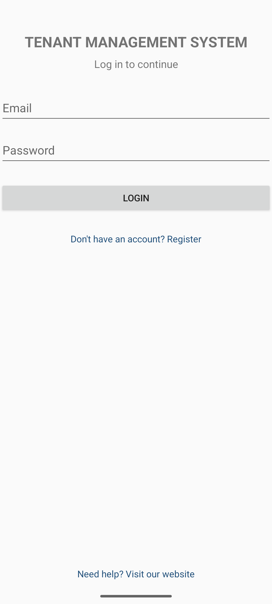
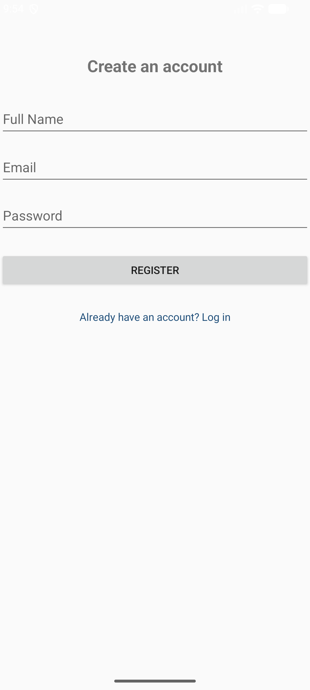
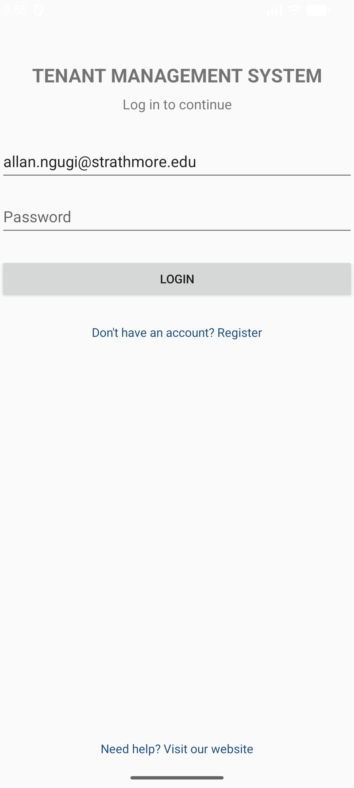
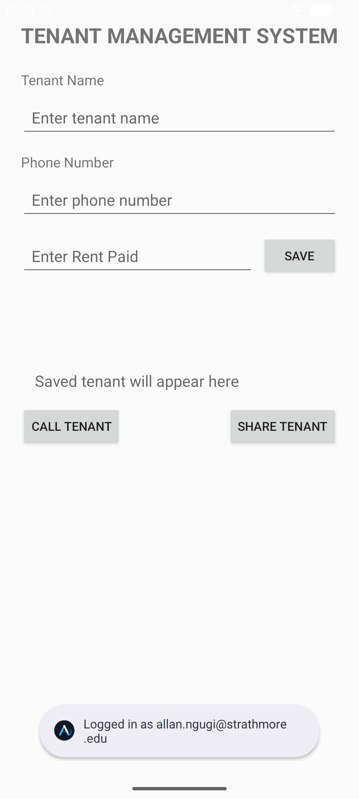
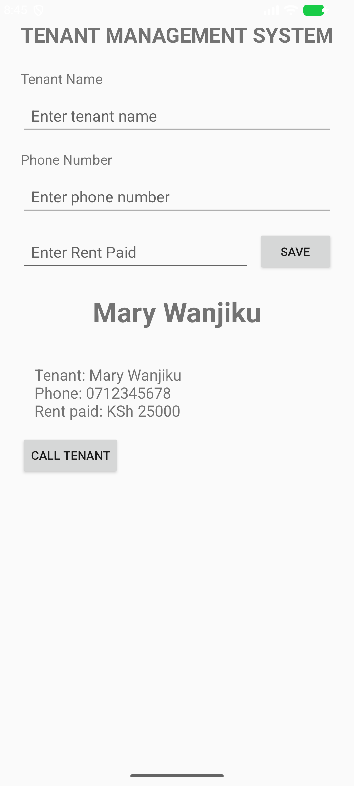
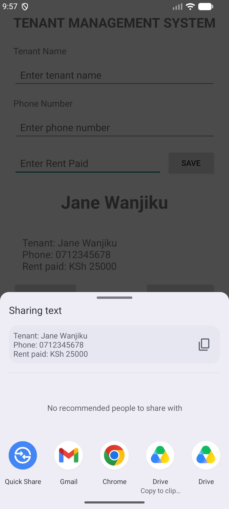

<h1 align="center">TenantManagementSystem</h1>
<p align="center">
  <em>A property manager's app built with View Binding, Data Binding and Intents.</em>
  <br>
  <br>
  <a href="#overview">Overview</a> ·
  <a href="#screenshots">Screenshots</a> ·
  <a href="#what-it-does">What It Does</a> ·
  <a href="#how-the-screens-connect">How the Screens Connect</a> ·
  <a href="#how-to-run">How to Run</a> ·
  <a href="#project-structure">Project Structure</a> ·
  <a href="#built-with">Built With</a> ·
  <a href="#build-notes">Build Notes</a> ·
  <a href="#author">Author</a>
  <br>
  
  
  
  
</p>

---

TenantManagementSystem is the Android app built for the BBT 3.2 Mobile Application Development practicals at Strathmore University. It starts with a Login and a Register screen, moves to an Add Tenant screen where a property manager enters a tenant's name, phone number and rent paid, and can hand a saved tenant's number to the phone dialer or open a web page.

The Lesson 6 practicals walk through the progression from a static screen, to View Binding, to Data Binding, then add navigation: multiple Activities, explicit Intents, passing data with `putExtra`, and implicit Intents that ask other apps to do things. The app is as much a demonstration of those techniques as it is a usable form.

## Overview

The app has three Activities. `LoginActivity` is the first screen: it takes an email and password, opens `MainActivity` with an explicit Intent, and links to `RegisterActivity`. `RegisterActivity` validates three fields, then returns to Login carrying the email with `putExtra("EMAIL")`. `MainActivity` is the Add Tenant screen: its layout is a ConstraintLayout that holds a title, three inputs (name, phone, rent), a SAVE button, a CALL TENANT button and a result area.

Kotlin reaches the views through View Binding, and the result area reads a `Tenant` object directly through Data Binding. The point of the exercise is the separation of concerns. `MainActivity` builds a `Tenant` and hands it to the layout, and the layout decides how that `Tenant` is displayed. Changing the display format means editing the `Tenant` class, not the activity.

## Screenshots

<p align="center">
  
  
  
</p>
<p align="center">
  <em>Login, Register, and Login again after Register carried the email across with putExtra.</em>
</p>

<p align="center">
  
  
</p>
<p align="center">
  <em>The Add Tenant screen as it opens — greeted with the email carried from Login — and after a tenant is saved through Data Binding.</em>
</p>

<p align="center">
  
</p>
<p align="center">
  <em>SHARE TENANT hands the saved tenant's summary to the Android share sheet through an implicit ACTION_SEND Intent.</em>
</p>

On the Add Tenant screen the name renders in large bold text and the summary is filled in by Data Binding, the three inputs clear on save, CALL TENANT hands the saved number to the dialer, and SHARE TENANT hands the tenant's summary to any app that can send text.

## What it does

- Opens on a Login screen and reaches every view through View Binding, so a wrong id fails at compile time instead of crashing at runtime.
- Validates the Login fields and blocks the move to the dashboard when either is empty.
- Opens `MainActivity` (the Add Tenant screen) with an explicit Intent, then `finish()`es so Back does not return to Login.
- Carries the registered email from Register to Login with `putExtra("EMAIL")` / `getStringExtra`, and uses `FLAG_ACTIVITY_CLEAR_TOP` so Register does not stack a second Login.
- Greets the logged-in user: Login forwards the email to `MainActivity` with `putExtra("EMAIL")`, which shows a *Logged in as …* toast.
- Opens the Strathmore website from the Login screen with an implicit Intent (`ACTION_VIEW` + `Uri.parse`).
- Renders a `Tenant` object through Data Binding with `android:text="@{tenant.summary()}"`.
- Holds tenant data in a `Tenant` data class (`name`, `phone`, `rent`) with a `summary()` method.
- Validates the tenant name: an empty name shows a field error and blocks the save.
- Shows the saved tenant's name in large bold text above the summary, and clears the three inputs after a save.
- Dials the last saved tenant with an implicit Intent (`ACTION_DIAL` + `"tel:$phone"`), warning "Save a tenant first" if nothing is saved yet.

## How the screens connect

```
                    implicit Intent (ACTION_VIEW)
LoginActivity ───────────────────────────────────▶ Browser
   │     ▲
   │     │ explicit Intent + putExtra("EMAIL")
   │     │
   │  RegisterActivity
   │
   │ explicit Intent
   ▼
MainActivity ─── implicit Intent (ACTION_DIAL) ───▶ Phone dialer
```

An explicit Intent names the exact screen to open (`Intent(this, MainActivity::class.java)`). An implicit Intent only describes what you want done, and Android finds an app on the phone that can do it (open a web page, dial a number).

## How to run

### Android Studio (recommended)

1. Open the project folder in Android Studio.
2. Let Gradle sync finish.
3. Start an emulator from Device Manager, or connect a device with USB debugging enabled.
4. Select the `app` run configuration and press Run.

### Command line

Build a debug APK:

```bash
./gradlew assembleDebug
```

Install and launch on a running emulator or connected device:

```bash
./gradlew installDebug
adb shell am start -n com.example.tenantmanagementsystemgroupa/.LoginActivity
```

The website link needs an emulator image with a browser (Google Play or Chrome); the dialer link works on any phone image.

## Project structure

```
TenantManagementSystem/
├── app/
│   ├── build.gradle.kts
│   └── src/main/
│       ├── AndroidManifest.xml
│       ├── java/com/example/tenantmanagementsystemgroupa/
│       │   ├── LoginActivity.kt
│       │   ├── RegisterActivity.kt
│       │   ├── MainActivity.kt
│       │   └── Tenant.kt
│       └── res/
│           ├── layout/
│           │   ├── activity_login.xml
│           │   ├── activity_register.xml
│           │   └── activity_main.xml
│           └── values/
│               ├── strings.xml
│               ├── themes.xml
│               └── colors.xml
├── gradle/
│   ├── libs.versions.toml
│   └── wrapper/
├── build.gradle.kts
├── settings.gradle.kts
├── gradle.properties
├── screenshots/
│   ├── login.png
│   ├── register.png
│   ├── login-prefilled.png
│   ├── add-tenant-welcome.png
│   ├── add-tenant-saved.png
│   └── add-tenant-share.png
└── README.md
```

## Built with

- Kotlin 2.2.10
- Android Gradle Plugin 9.1.1
- Gradle 9.3.1
- AndroidX AppCompat 1.7.0
- AndroidX ConstraintLayout 2.2.1
- AndroidX Core KTX 1.13.1
- minSdk 24, compileSdk 36, targetSdk 36

## Build notes

Android Studio 2026.1 ships Android Gradle Plugin 9, where Kotlin support is built in. Two consequences for anyone following the original practical guide:

- The Kotlin Android plugin is not applied. Applying it fails with `Cannot add extension with name 'kotlin'`.
- `kotlin-kapt` is not compatible with built-in Kotlin, and Data Binding no longer needs it. Turning on `dataBinding = true` is enough for the binding classes to be generated.

The project builds clean with `./gradlew assembleDebug`.

## Author

- Allan Ngugi - 191250

## License

UNLICENSED. Coursework submission for BBT 3.2 Mobile Application Development.
